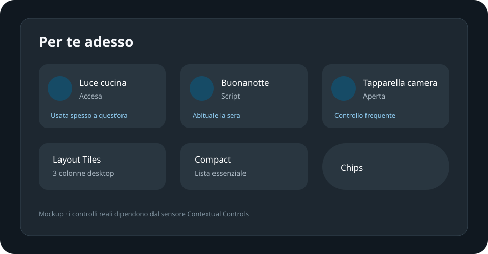

# Contextual Controls Card

A Home Assistant Lovelace card for [`Contextual Controls`](https://github.com/monkeypr00f/contextualcontrols). It turns the ordered `entities` attribute of the integration sensor into useful, user-initiated controls. The card never makes autonomous service calls.

## Install with HACS

1. Open HACS → menu → Custom repositories.
2. Add `https://github.com/monkeypr00f/contextual-controls-card` as **Dashboard**.
3. Download the card and refresh Home Assistant.
4. Edit a dashboard, choose **Add card**, then select **Contextual Controls**.

HACS registers the JavaScript resource automatically. The card has a visual editor, so YAML is optional.

## Visual editor

Choose the sensor, optional title, maximum controls, desktop/mobile columns, tap action, icon policy, and whether to show state, reason, score, last update, or pinned controls. Three layouts are implemented:

- **Tiles**: responsive 3-column desktop / 2-column mobile grid by default.
- **Compact**: one concise control per row.
- **Chips**: wrapping, space-efficient controls.

Enable **Dynamic title** for Good morning / For you now / This evening / Before sleep. Leaving `max_controls` empty uses the number already selected by the integration.

## Actions and safety

Automatic tap toggles lights, switches, fans, and input booleans; activates scenes and scripts; and presses buttons. Climate, media players, covers, locks, vacuums, selects, numbers, alarm panels, and sirens open more-info. Hold always opens more-info. Every action requires a user gesture.

## Manual installation

Copy `dist/contextual-controls-card.js` to `/config/www/contextual-controls-card.js`, then add `/local/contextual-controls-card.js` as a JavaScript module resource.

## Requirements

- Home Assistant 2026.9 or newer
- Contextual Controls 0.4.0 or newer

## Development

Run `npm run check` and `npm test`. The repository is distributed as a separate HACS Dashboard package so frontend updates do not require restarting Home Assistant.

MIT licensed.
